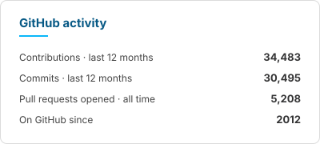
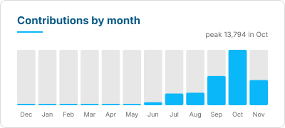

<h1 align="center">Zia Saidi</h1>
<!-- profile:managed:start -->

<strong>Software architect · founder of Awna</strong>

  I connect the disciplines that make software work. Thirty years of building software end
  to end, from servers and databases to the teams and companies around them. With AI, that
  breadth now does the work of a whole team.

  <a href="https://zia.saidi.pro">zia.saidi.pro</a> ·
  <a href="https://zia.saidi.pro/request-for-proposal">Request a proposal</a> ·
  <a href="https://fantastical.app/zia/intro">Book a call</a> ·
  <a href="https://www.linkedin.com/in/ziasaidi/">LinkedIn</a> ·
  <a href="https://www.patreon.com/ziazizi">Support my work on Patreon</a>

---

## Work that moved the number

- **[ATM Gurus](https://zia.saidi.pro/projects/atm-gurus)** — a rebuilt parts-and-services
  storefront drove dramatic, sustained growth in monthly sales within six months, with no
  increase in advertising spend.
- **[Christian Brands](https://zia.saidi.pro/projects/christian-brands)** — two brand
  storefronts unified behind a legacy ERP, with **45,000+ products** migrated onto the new
  platform.
- **[BostonPads](https://zia.saidi.pro/projects/bostonpads)** — one listings engine,
  application management system, and custom middleware behind a network of more than
  **40 branded sites**.
- **[Openbay](https://zia.saidi.pro/projects/openbay)** — the UI, public-facing APIs and
  microservices behind a B2C and B2B auto-repair marketplace. I proposed and built the
  partnership program, user subscriptions and partner portal that expanded the company's
  revenue opportunities.

<a href="https://zia.saidi.pro/projects">See all the work →</a>

## How I build

Every project runs on a managed AI team: a planner, an implementer, an independent reviewer
and an asset generator. Each seat follows my written engineering standards and is filled by
the model family best suited to it, so a review never shares the author's blind spots. A
person signs off every delivery, and every correction goes back into the standards.

- A written operating system: verification before claims, test-first by default, one change
  per commit, and a check that runs before anything merges
- More than 30 written skills that hold the standards for each part of the work
- Every open decision settled up front, so the agents work from complete plans and nothing
  stalls mid-build
- Written project notes carry context between sessions, so month six moves as fast as week one
- Independent pieces built side by side, then reviewed by me

<a href="https://awna.ai/how-we-work/">See how I build →</a>

<!-- profile:managed:end -->
<!-- profile:projects:start -->
## Open-source projects

- **[voice](https://github.com/awna-ai/voice)** — A kit for building your own ai assistant
- **[radio](https://github.com/awna-ai/radio)** — One daemon per computer that carries rooms and messages between local apps and other computers
- **[zizi-skills](https://github.com/ziazon/zizi-skills)** — A skill library for disciplined software work: planning, test-first implementation, code and security review, git hygiene, and session handoff.
- **[dotfiles](https://github.com/ziazon/dotfiles)**

<!-- profile:projects:end -->
## GitHub activity

  <picture>
    <source media="(prefers-color-scheme: dark)" srcset="https://raw.githubusercontent.com/ziazon/ziazon/master/assets/stats-dark.svg">
    
  </picture>
  <picture>
    <source media="(prefers-color-scheme: dark)" srcset="https://raw.githubusercontent.com/ziazon/ziazon/master/assets/activity-dark.svg">
    
  </picture>

These cards are generated by [a workflow in this repository](https://github.com/ziazon/ziazon/blob/master/.github/workflows/profile-monthly.yml)
and committed as static SVGs — no third-party service, no rate limits, and the job **fails
rather than publish a number it cannot verify**. The figures include private and client work,
which is most of what I ship; the public repositories here are a small slice of it.

## Sponsors

  <a href="https://www.patreon.com/ziazizi">
    <picture>
      <source media="(prefers-color-scheme: dark)" srcset="https://raw.githubusercontent.com/ziazon/.github/main/assets/sponsors-dark.svg">
      
    </picture>
  </a>
  <a href="https://www.patreon.com/ziazizi">
    <picture>
      <source media="(prefers-color-scheme: dark)" srcset="https://raw.githubusercontent.com/ziazon/.github/main/assets/supporters-dark.svg">
      
    </picture>
  </a>

## Stack

| | |
| --- | --- |
| **Languages** | TypeScript · JavaScript · PHP · Go · Python · Ruby · R |
| **Frontend** | Vue 3 · Vite · Pinia · SSR / SSG · Sass |
| **Backend** | NestJS · Node.js · Laravel · Ruby on Rails · FastAPI |
| **Data** | PostgreSQL · TypeORM · Oracle · TSQL |
| **Messaging** | NATS · RabbitMQ · ZeroMQ · Socket.io |
| **Infrastructure** | Docker · Terraform · Nomad · Consul · Vault · Kubernetes · GitHub Actions |
| **Quality** | Vitest · Playwright · TDD · CI-gated PRs |

## In the open

- **[dotfiles](https://github.com/ziazon/dotfiles)** — the shell and editor environment I
  actually work in.
- **[koga-discord-bot](https://github.com/ziazon/koga-discord-bot)** — a TypeScript Discord
  bot pulling game APIs for a gaming clan.

## Let's talk

Tell me about your project and I'll come back with a tailored proposal.

<a href="https://zia.saidi.pro/request-for-proposal">Request a Proposal</a> ·
<a href="https://fantastical.app/zia/intro">Book a call</a> ·
<a href="https://zia.saidi.pro/contact">Send me a message</a>
